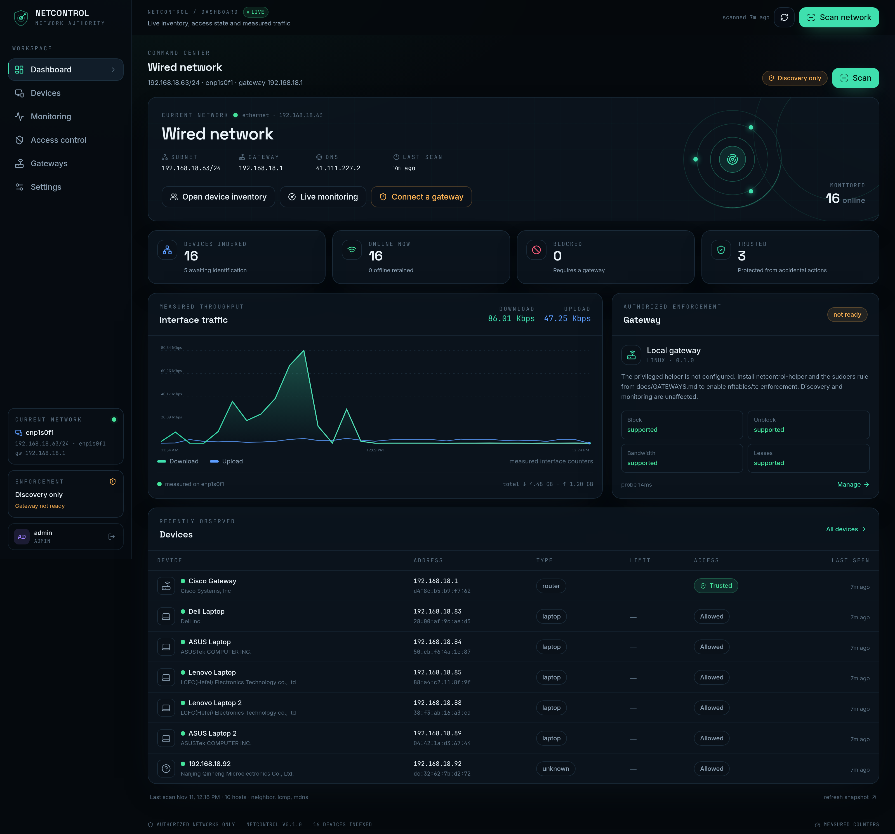
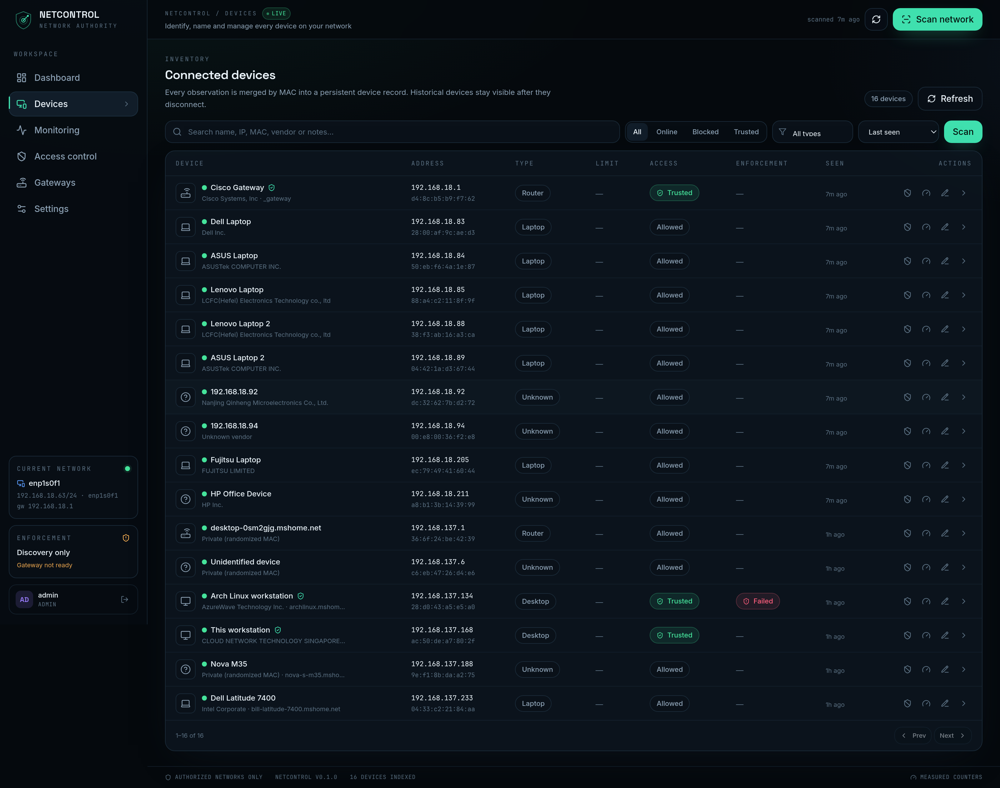
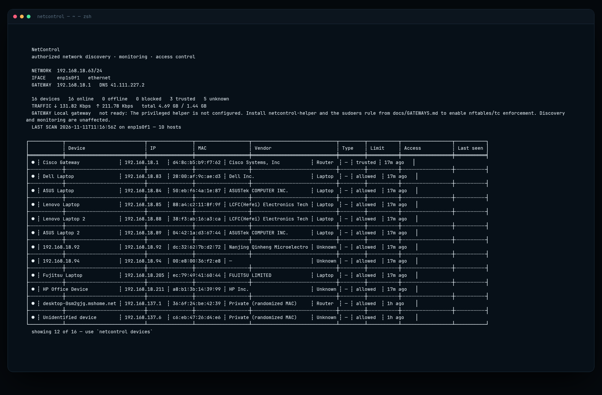
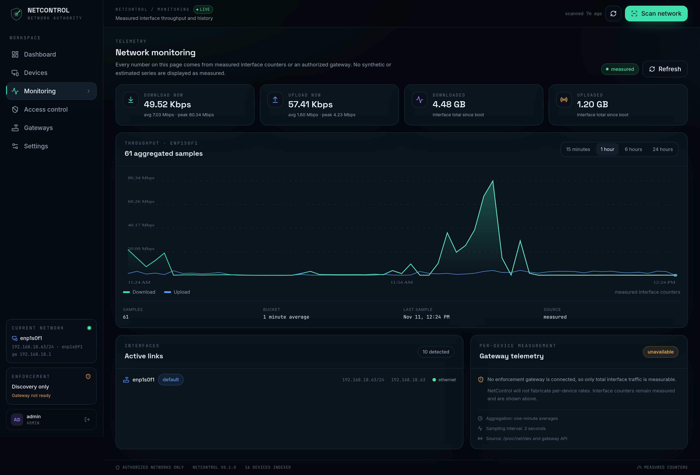
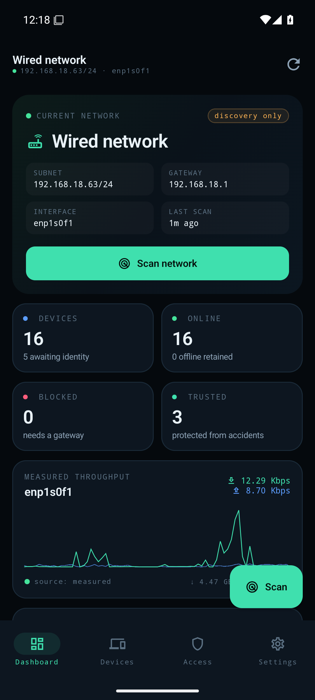
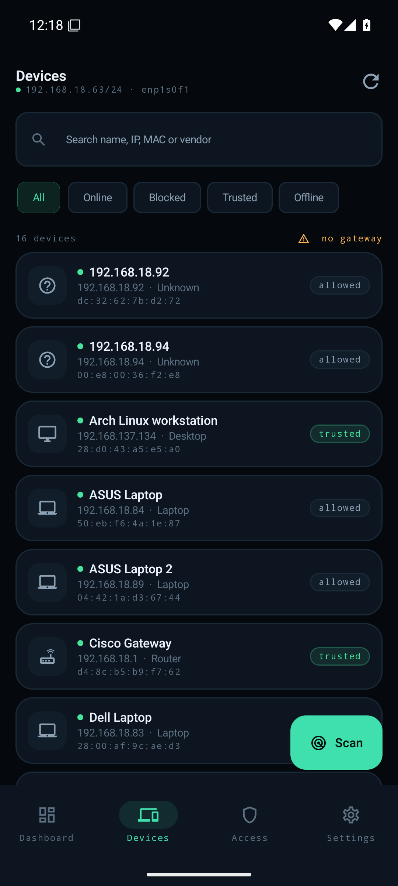
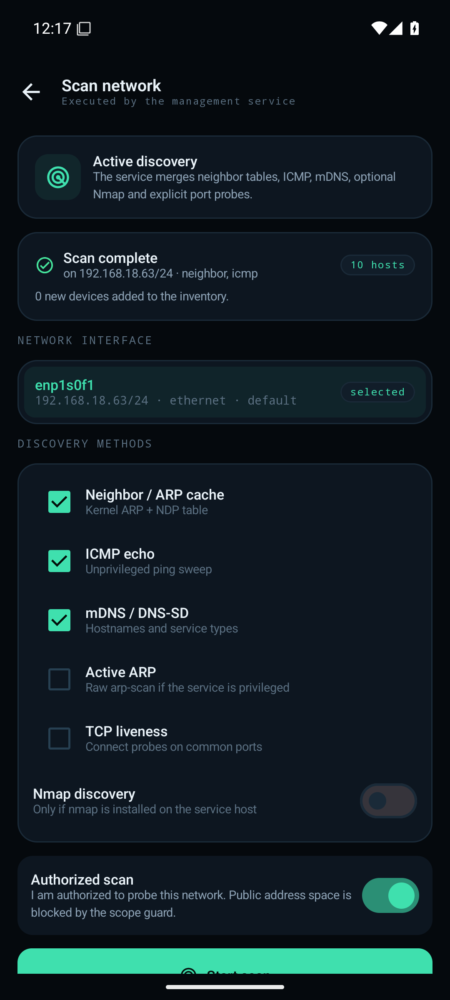
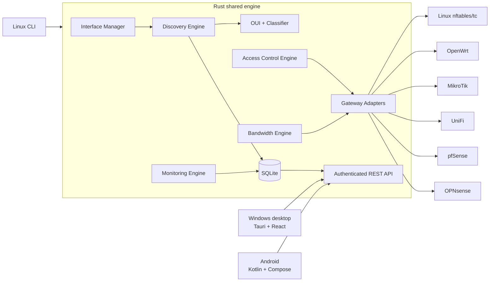

# NetControl

**Authorized network discovery, monitoring and verified access control — one Rust engine, three interfaces.**

NetControl discovers every device on the network the administrator is connected to, identifies it from IEEE OUI data and service fingerprints, keeps a persistent history, measures real interface traffic, and enforces blocking or bandwidth limits **through an authorized gateway** — verifying every change by reading the gateway state back.

> If NetControl cannot verify a change, it reports it as unsupported or failed. It never marks a device blocked or limited unless the gateway confirms it.



| Desktop — Devices | Linux CLI |
| --- | --- |
|  |  |
| **Desktop — Monitoring** | **Android — Dashboard** |
|  |  |
| **Android — Devices** | **Android — Scan result** |
|  |  |

More screenshots: [`screenshots/`](screenshots/).

---

## What is real

| Capability | Status |
| --- | --- |
| Interface + network detection (Wi-Fi, Ethernet, USB Ethernet, virtual, multiple defaults) | Implemented and tested on Omarchy/Arch with Wi-Fi + Ethernet simultaneously |
| Neighbor/ARP cache discovery, unprivileged ARP priming | Implemented; validated on a real /24 |
| Unprivileged ICMP sweep (Linux ping sockets) | Implemented; validated on real Wi-Fi and Ethernet |
| mDNS/DNS-SD hostnames and service types | Implemented (compressed DNS parser, split queries); validated against live mDNS responders |
| Optional Nmap discovery and port scanning | Implemented via XML parsing; nmap 7.99 present on the test host |
| IEEE OUI vendor lookup + device classification | 40,471 OUI/MA-M/MA-S assignments embedded |
| SQLite persistence, history, migrations, audit | Implemented and unit-tested |
| REST API, login, opaque sessions, role checks, rate limiting, SSE | Implemented; integration-tested over real HTTP |
| Linux enforcement: nftables block set + tc HTB/policing | **Executed and verified in a capability-isolated container** (see below) |
| OpenWrt: UCI/fw4 + tc over SSH | Implemented; command/protocol tests, requires real router validation |
| MikroTik RouterOS native API + address-list/queues | Implemented; protocol tests; requires real router validation |
| UniFi Network: block-sta + user-group QoS | Implemented; requires real controller validation |
| pfSense: SSH `easyrule` + pfctl verification | Implemented; requires real firewall validation |
| OPNsense: REST alias + rule management | Implemented; requires real firewall validation |
| Desktop UI (React/Tauri 2) | UI verified in browser against the live API; Tauri binary launches on Omarchy/Wayland |
| Windows installer | Source + CI workflow included; **must be built on Windows** (see [packaging/windows/BUILD.md](packaging/windows/BUILD.md)) |
| Android APK | Built, installed and exercised on an Android 35 emulator against the live service |

### Linux enforcement proof

Run inside an `archlinux` container with only `CAP_NET_ADMIN`/`CAP_NET_RAW` and a dummy LAN interface:

```
block 10.99.0.50      → verified=true,  nft list set inet netcontrol blocked contains 10.99.0.50
limit 10/2 Mbps       → verified=true,  tc htb class 1:50 + u32 filters present
unblock / clear       → verified=true,  objects removed
```

The helper is the only privileged component and accepts a JSON allowlist — it never runs a shell. See [docs/GATEWAYS.md](docs/GATEWAYS.md).

---

## Architecture



The CLI uses the shared engine locally; the desktop application embeds it through Tauri commands; Android uses the authenticated API. All three share device identity, classification, audit semantics and the same enforcement contract.

---

## Quick start (Omarchy / Arch Linux)

### 1. Build

```bash
sudo pacman -S --needed base-devel rust cargo nmap nftables iproute2 openssh
cargo build --release -p netcontrol-cli -p netcontrol-helper
```

Use the packaged build:

```bash
cd packaging/arch
makepkg -si
```

### 2. Discover your network

```bash
netcontrol interfaces
netcontrol scan --yes
netcontrol devices
netcontrol device info 192.168.1.50
netcontrol monitor
```

`scan` without `--yes` asks for explicit authorization. Public address space is refused unless `--allow-public` is supplied and the service is configured to allow it.

### 3. Add an authorized gateway

No gateway is required for discovery and monitoring. Enforcement is enabled only after a real gateway is configured and probed successfully.

Linux gateway on this host (recommended for a home-lab gateway):

```bash
sudo install -Dm755 target/release/netcontrol-helper /usr/lib/netcontrol/netcontrol-helper
echo "$(id -un) ALL=(root) NOPASSWD: /usr/lib/netcontrol/netcontrol-helper" |
  sudo tee /etc/sudoers.d/netcontrol >/dev/null
sudo chmod 0440 /etc/sudoers.d/netcontrol

netcontrol gateway add --kind linux --host local --interface enp1s0f1
netcontrol gateway test
netcontrol block 192.168.1.50 --for 1h --yes
```

OpenWrt / RouterOS / UniFi / pfSense / OPNsense setup: [docs/GATEWAYS.md](docs/GATEWAYS.md).

### 4. Run the management service

```bash
netcontrol serve --listen 127.0.0.1:8787
```

The first administrator password is written to `~/.config/netcontrol/initial-admin-password.txt` (mode `0600`) and deleted after the first administrator login. Open the desktop app or another client and sign in.

For remote access, use TLS:

```bash
netcontrol serve --listen 0.0.0.0:8787 \
  --tls-cert /etc/netcontrol/server.crt \
  --tls-key  /etc/netcontrol/server.key \
  --allow-remote
```

NetControl refuses an unencrypted non-loopback listener unless
`NETCONTROL_ALLOW_INSECURE_REMOTE=1` is explicitly set for an isolated lab.

### 5. Desktop

```bash
cd apps/desktop
npm ci
npm run dev          # browser UI against the service
npm run tauri dev    # native Tauri window (local shared engine)
```

Windows installers: [packaging/windows/BUILD.md](packaging/windows/BUILD.md) / [`.github/workflows/windows.yml`](.github/workflows/windows.yml).

### 6. Android

A working debug APK is included at [`deliverables/netcontrol-android-debug.apk`](deliverables/netcontrol-android-debug.apk).

```bash
adb install -r deliverables/netcontrol-android-debug.apk
```

On an emulator use `http://10.0.2.2:8787/api/v1`; on a physical device use the
service's LAN address (HTTPS strongly recommended). Android never performs
enforcement itself — it controls an authorized service.

Build it yourself:

```bash
cd apps/android
./gradlew assembleDebug
```

See [docs/INSTALL.md](docs/INSTALL.md) for SDK versions and exact JDK commands.

---

## Feature highlights

- **Network detection without assumptions** — no hard-coded `192.168.1.0/24`; reads CIDR, gateway, DNS, MAC and interface kind from the host, supports multiple simultaneous default routes.
- **Five discovery methods** — neighbor/NDP, unprivileged ARP priming, ICMP, mDNS, optional Nmap + explicit TCP ports.
- **Persistent identity** — devices merged by MAC, history kept after disconnect, manual names/categories, trust and blacklist semantics.
- **Premium dark UI** — custom design, no generic dashboard template; real charts from measured counters.
- **Honest bandwidth** — distinguishes configured limits, measured traffic and unavailable telemetry. Never fabricates per-device rates.
- **Verified enforcement** — adapter reads the rule back; only verified state is persisted as enforced.
- **Extensible gateway layer** — one trait, six adapters, capabilities reported per adapter.
- **Security-first** — Argon2id, AES-256-GCM credential sealing, SHA-256 session digests, scoped probing, audit log, HTTPS enforcement, CORS allowlist, input validation, helper allowlist.

---

## Repository layout

```
crates/
  netcontrol-core/        models, SQLite + migrations, crypto, OUI, classification
  netcontrol-discovery/   interfaces, ARP priming, ICMP, mDNS, nmap, orchestration
  netcontrol-gateway/     adapter trait + Linux/OpenWrt/MikroTik/UniFi/pfSense/OPNsense
  netcontrol-service/     orchestration, auth, REST API, monitor, scheduler, SSE
  netcontrol-cli/         `netcontrol` binary (local + remote modes)
  netcontrol-helper/      privileged whitelist-only nftables/tc helper
apps/desktop/             React + TypeScript + Tailwind UI and Tauri 2 backend
apps/android/             Kotlin + Jetpack Compose management client
docs/                     architecture, API, install, gateways, security, limitations
packaging/                Arch PKGBUILD, systemd units, Windows build workflow
screenshots/              real screenshots of the desktop and Android apps
deliverables/             built binaries and APK
```

---

## Tests

```bash
cargo test -p netcontrol-core -p netcontrol-discovery -p netcontrol-gateway -p netcontrol-service
```

```bash
# live discovery against the current Wi-Fi/Ethernet
cargo run -p netcontrol-discovery --example live_scan -- wlp2s0
cargo run -p netcontrol-discovery --example mdns_probe -- 192.168.1.10
```

Android:

```bash
cd apps/android && ./gradlew testDebugUnitTest
```

Tests cover MAC/CIDR/rate validation, scope guards, OUI, classifier, AES-GCM
roundtrip/tamper, Argon2 policy, session digests, DB migrations/upserts/offline
transitions, nmap XML, mDNS packet parsing, RouterOS word framing, UniFi/OPNsense
parsing, tc command plans, helper validation, and a full HTTP integration test
proving auth, confirmation requirements, the scope guard and the
"never claim unverified enforcement" contract.

---

## Documentation

- [Architecture](docs/ARCHITECTURE.md)
- [Installation](docs/INSTALL.md)
- [Gateway integrations](docs/GATEWAYS.md)
- [Security model](docs/SECURITY.md)
- [Limitations and honest support matrix](docs/LIMITATIONS.md)
- [REST API](docs/API.md) / [OpenAPI 3.0](docs/openapi.json)
- [Development guide](docs/DEVELOPMENT.md)
- [Deliverables checklist](docs/DELIVERABLES.md)

## License

MIT — see [LICENSE](LICENSE).
